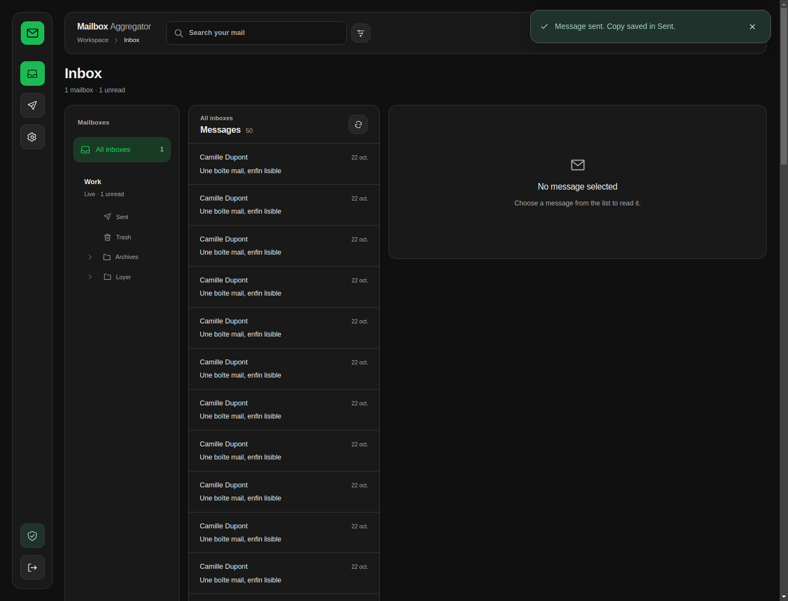
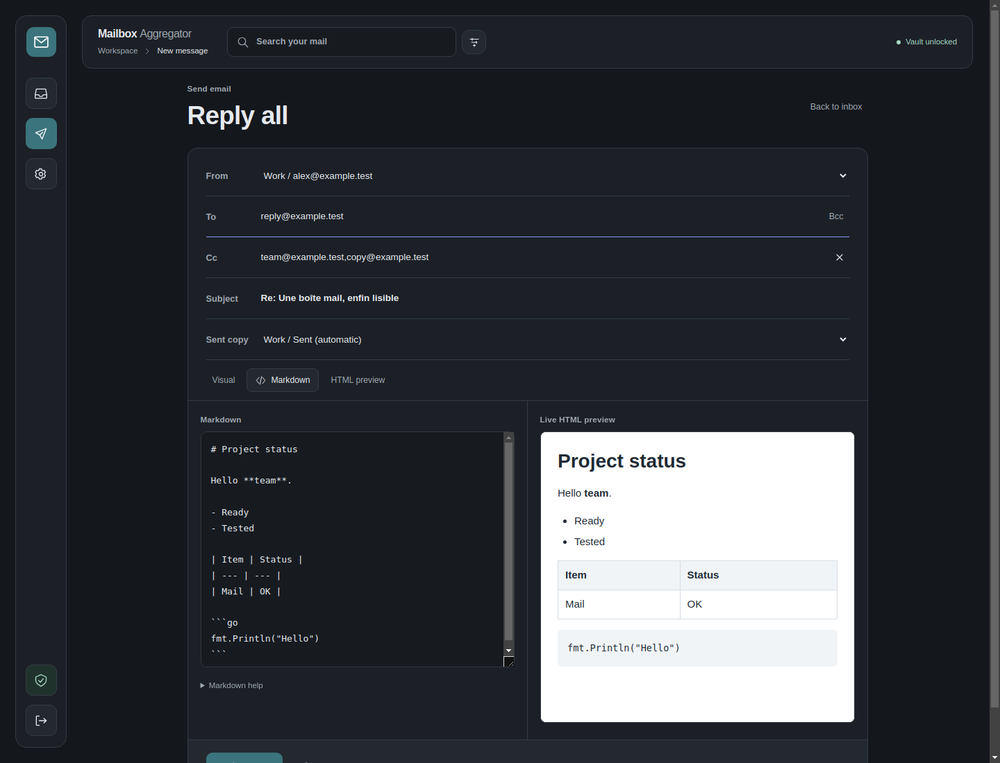
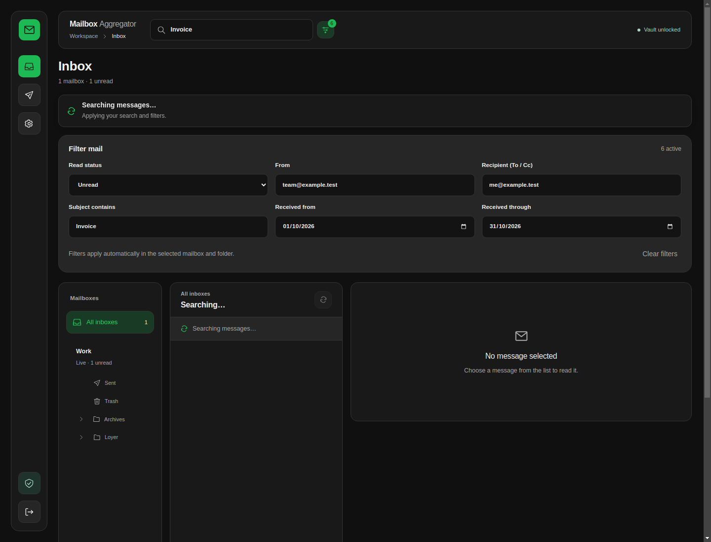

# 📬 **Mailbox Aggregator**

**Mailbox Aggregator** is a self-hosted webmail app that brings IMAP inboxes and SMTP senders together with encrypted account settings and privacy-focused email reading.

Built with **Go, Gin, Vue 3 and TypeScript**, it uses encrypted profile files and reads mail on demand from your providers.

The project is under active development. See [Security](docs/SECURITY.md) and [Deployment](docs/DEPLOYMENT.md) for its operating assumptions and current limitations.

---

## Feature status

| Status | Capabilities |
| --- | --- |
| Implemented | Isolated encrypted user profiles, IMAP/SMTP identities, inbox/folder reading, provider search and filters, Seen/Flagged/Answered, selected-message batches, same-account copy/move, folder CRUD/subscriptions, safe Trash moves, reply/forward/redirect, attachments/source, optional Sent copies, themes, encrypted tab resume and local drafts, encrypted configuration import/export, password changes and optional VMK rotation, optional IMAPS/SMTPS gateways. |
| Partial | Non-persistence evidence covers isolated application/TLS/process tests; deployment proxy/swap/core dumps and broad provider compatibility still need qualification. Unified pagination, browser coverage and production hardening remain limited. |
| Planned | IMAP Drafts, OAuth2, cross-account transfers, unified folder views, signatures, contacts, independent security review. |
| Unsupported | Admin password recovery/decryption, permanent deletion from the reader, an application-side disk mail archive or SMTP outbox spool. |

Local drafts survive navigation/locking in encrypted browser storage for seven
days; they are not provider-side Drafts or available across devices. A pending
submission makes the restored composer read-only until its outcome is known.
Configuration export uses a separate password. Import replaces mailboxes,
senders and preferences and signs out all sessions of the current user; export
the current settings first. See [API](docs/API.md), [Security](docs/SECURITY.md)
and the [changelog](CHANGELOG.md) for contracts and limits.

---

## ✨ **Key Concept - Encrypted Profiles, Mail with Your Providers**

Each user has a separate encrypted vault for mailbox connections, sender credentials and preferences. Email content is fetched when needed and is not kept in a local mailbox archive.

### How it works

1. **Sign in and unlock**: OPAQUE handles authentication, and the browser unlocks the vault using the password you entered.
2. **Configure your identities**: add IMAP mailboxes to receive email and SMTP sender addresses to send it. Settings are encrypted in the browser before storage.
3. **Read and send**: the unlocked browser temporarily activates provider credentials for its session. The Go backend connects to the selected mail servers over verified TLS/STARTTLS.
4. **Link when useful**: a receiving mailbox can be linked to a sender for replies and optional copies in its Sent folder.
5. **Lock the vault**: manual locking, logout and inactivity clear local unlock material and stop active mailbox monitoring.

**Security boundary:** the backend can access activated provider credentials and message content in memory while handling mail. Protect both the host and the browser. Encrypted storage does not protect an already compromised running application.

---

## 🔍 **Features Overview**

### 📥 **Receive and Organize Email**

| Feature | Description |
|---------|-------------|
| Multiple mailboxes | Merge inboxes in one view or browse each receiving identity separately. |
| Live updates | IMAP IDLE for inbox activity, with configurable polling fallback and recovery after temporary network failures. |
| Folder hierarchy | Expand nested folders using the server's hierarchy separator. |
| Folder mapping | Choose Automatic, None or an existing server folder for Sent, Drafts, Trash, Archive, Spam, All mail and Outbox. |
| Search | Search message text and headers on the IMAP server, beyond the summaries already loaded. |
| Combined filters | Filter by read status, sender, recipient in To/Cc, subject and received-date range. |
| Read status | Mark messages as read/unread manually or enable automatic read marking per mailbox. |
| Safe deletion | Move individual messages to the existing Trash folder. Permanent deletion is not exposed. |

### ✉️ **Compose and Send**

| Feature | Description |
|---------|-------------|
| SMTP identities | Configure independent sender addresses with their own credentials and optional mailbox links. |
| Visual editor | Headings, lists, links, quotes, colors, highlighting, font sizes and alignment. |
| Markdown | Write Markdown with headings, tables, lists and fenced code, with a live HTML preview. |
| HTML preview | Preview the draft in an isolated, local sandbox before sending. |
| Recipients | To is visible; Cc and Bcc can be added when needed. |
| Attachments | Add or remove attachments, up to 20 files and 10 MiB total. |
| Mail actions | Reply, reply all, forward with attachments, or redirect the original message with Resent headers. |
| Reply address | Optionally prefer an SMTP address matching the original To/Cc recipients. |
| Sent copies | Save a copy in a linked IMAP mailbox's mapped Sent folder after SMTP acceptance. |
| External mail clients | Optional IMAPS/SMTPS gateways with per-user passwords, a selected inbox and SMTP routing limited to that user's enabled sender addresses. |
| Delivery feedback | Return to the inbox after sending; a failed IMAP copy is reported separately from SMTP delivery. |

### 🛡️ **Privacy and Account Security**

| Feature | Description |
|---------|-------------|
| Encrypted settings | Browser-side Argon2id, AES-256-GCM vault wrapping, and independent HKDF-derived file keys. |
| OPAQUE authentication | RFC 9807 registration and login, with no insecure password fallback. |
| Isolated profiles | Per-user storage, authenticated API access and session-scoped provider credentials. |
| External images | Blocked by default, with visible placeholders and one-message loading consent. |
| Sender/domain permissions | Allow external images for one address or an exact domain such as `*@example.com`; remove individual rules in Settings. |
| Protected HTML reader | Sanitized HTML in a sandbox; scripts, forms and active embedded content remain blocked. |
| Original source | Inspect full headers and MIME source, or download the original `.eml` file. |
| Vault locking | Configurable inactivity locking and optional encrypted tab resumption across reloads. |
| Connection tests | Test IMAP/SMTP authentication without sending mail, limited to one attempt per IP every 30 seconds. |

Trusting an address or domain permits image loading; it does not authenticate the sender. Domain rules match that exact domain and do not include its subdomains.

### 🎨 **Appearance**

| Theme | Appearance |
|-------|------------|
| **Slate** | Muted blue gray. |
| **Paper** | Light, warm neutrals. |
| **Groove** | Charcoal with green accents. |
| **Cinema** | Black with red accents. |
| **System** | Follow the device's light/dark preference. |

Themes are saved in **each user's encrypted profile** and restored after sign-in and vault unlock on other devices. The interface supports desktop and mobile layouts, loading/search indicators and temporary floating notifications.

---

## 🖼️ **Interface**



<details>
<summary><strong>Markdown editor and HTML preview</strong></summary>



</details>

<details>
<summary><strong>Search and combined filters</strong></summary>



</details>

Screenshots use synthetic messages and demonstration addresses.

---

## 📥 **Installation**

### Requirements

| Workflow | Requirements |
|----------|--------------|
| Docker | Docker Engine and Docker Compose. The build includes the frontend and Go binary. |
| Native | Go **1.27.0** or a compatible 1.27 patch release, Node.js **24**, npm, and `make` for the helper commands. |
| Browser access | HTTPS for remote access. Local development can use `http://localhost:8080`. |

### 1. Clone and configure

```sh
git clone https://github.com/PHD59fr/mailbox-aggregator.git
cd mailbox-aggregator
cp .env.example .env
chmod 600 .env
```

The first startup generates **`data/opaque_server_setup`** automatically when
`OPAQUE_SERVER_SETUP` is empty and no accounts exist. The file uses mode **0600**
and is reused on later starts. Persist and back up the complete data directory:
the authentication setup must remain stable. It is not the vault decryption key.

Existing deployments may keep their original `OPAQUE_SERVER_SETUP` supplied
through the environment or `.env`. An externally supplied setup is not copied
into the data directory. If both sources exist, they must match. A missing key
with existing accounts, or an invalid key file, stops startup and requires
restoring the original key.

For an explicitly managed setup, the optional generator remains available:

```sh
go run ./cmd/opaque-setup
```

With Docker only, generate it using the Go build image:

```sh
docker run --rm -v "$PWD:/src" -w /src golang:1.27.0-alpine \
  go run ./cmd/opaque-setup
```

If using this optional mode, supply the output as `OPAQUE_SERVER_SETUP` and keep
a protected backup. Changing it invalidates existing authentication records.

### 2. Start with Docker Compose

```sh
mkdir -p data
APP_UID="$(id -u)" APP_GID="$(id -g)" docker compose up -d --build
```

The included Compose file publishes port **8080** and persists profiles under `./data`. Use an HTTPS reverse proxy before signing in remotely. Compose enables production mode and Secure session cookies; a plain HTTP LAN/IP address will not provide the required browser security context and cookie behavior.

The image:

- Builds the Vue application and embeds it in the Go binary.
- Strips and compresses the binary with **UPX** in the Alpine Go build stage, then checks its integrity.
- Runs from **scratch** with TLS certificates, timezone data and an unprivileged user.
- Uses a read-only root filesystem, dropped capabilities and a bounded temporary filesystem under Compose.

The host `data/` directory must belong to the configured container UID/GID. Existing data must retain its restrictive Unix permissions. See [Deployment](docs/DEPLOYMENT.md) for ownership, proxy and backup details.

### 3. Run the published image directly

Once the updated image has been published, run it directly. A new installation
needs no `.env` or manually generated authentication key: the key and local TLS
certificates are created automatically in the mounted data directory. The command
below enables both mail gateways:

Prepare the bind mounts **as root** (or use `sudo` for the ownership/permission
commands). The published image runs as UID/GID **1000:1000**, even when Docker is
started by root. Run from the project directory containing `data/`,
not from inside `data/`:

```sh
mkdir -p data
chown -R 1000:1000 data
chmod 700 data

docker run -d --name mailbox-aggregator \
  --pull=always --restart unless-stopped \
  -p 8080:8080 -p 993:1993 -p 465:1465 \
  -v "$PWD/data:/app/data" \
  -e APP_DATA_DIR=/app/data \
  -e APP_ENV=production -e SESSION_COOKIE_SECURE=true \
  -e IMAP_PROXY_ENABLED=true -e SMTP_PROXY_ENABLED=true \
  -e MAIL_PROXY_HOSTNAME=mail.example.com \
  -e MAIL_PROXY_TLS_CERT= -e MAIL_PROXY_TLS_KEY= \
  phd59fr/mailbox-aggregator:latest
```

Replace `mail.example.com` with the DNS name or server IP used by your mail
clients. Run this command from the directory containing `data/`:

| Host path | Container path | Purpose |
|-----------|----------------|---------|
| `./data` | `/app/data` | Persistent accounts, encrypted settings, `opaque_server_setup` and generated TLS certificates. |

For an existing deployment that used `OPAQUE_SERVER_SETUP`, keep passing that
same value with `-e OPAQUE_SERVER_SETUP`, or optionally mount its existing `.env`
read-only at `/app/.env`. Such a file must be readable by UID/GID `1000:1000`.

The published image runs as UID/GID **1000:1000**; the mounted data must be writable
by that user. An error such as `chmod /app/data: operation not
permitted` usually means the bind mount is owned by a different host UID; correct
its ownership on the host before restarting the container. Accounts, encrypted settings,
the authentication setup and generated certificates persist in `./data`. The app
creates missing TLS files directly at startup under `data/proxy-certs` and reuses
them on restart. **Trust the generated self-signed certificate in your clients.**
Serve the web interface on port 8080 through HTTPS as described above. Pin a
version tag instead of `latest` if preferred.

### 4. Native build and local development

After configuring `.env` if needed:

```sh
go mod download
make web-install
make web-build
go build -o mailbox-aggregator ./cmd/server
./mailbox-aggregator
```

Open **http://localhost:8080** for local development. `make web-build` builds the frontend and copies it into the embedded assets used by the Go server.

The executable reads `.env` from the working directory, falling back to a file beside the executable. Process environment variables take precedence. Relative data paths from `.env` resolve beside that file. Shell expressions in `.env` are not evaluated.

---

### Optional IMAP and SMTP gateways

Set `MAIL_PROXY_HOSTNAME` in your existing `.env` to the DNS name or server IP
used by mail clients, then start Docker Compose directly:

```sh
docker compose -f compose.yaml -f compose.proxy.yaml up -d --build
```

Use `docker-compose` if that is your installed Compose command. If
`MAIL_PROXY_HOSTNAME` is empty or unspecified, Docker logs **"Mail proxies disabled:
MAIL_PROXY_HOSTNAME is not specified."**, skips certificate generation and starts
webmail with both gateways disabled.

Docker automatically creates a **local self-signed TLS certificate** in a
persistent `mail-proxy-certs` volume. **Explicitly trust that certificate in each
mail client.** It is preserved across restarts; no public CA issuance is implied.
To use an existing certificate instead, provide a directory containing
`fullchain.pem` and `privkey.pem`, readable by the container UID/GID:

Set `MAIL_PROXY_CERTS_DIR=./certs` in `.env` and run the same Compose command.
The base Compose file still runs webmail without the gateways.
The certificate initializer never overwrites existing
files; a partial, expired or mismatched pair requires operator correction.

In **Settings → Mail client access**, enable the services you want, select a
receiving mailbox and either one or all of your sending identities, and generate
a **dedicated proxy password**. In your mail client, use the configured hostname,
your Mailbox Aggregator login and this password, with **IMAP 993 / SSL/TLS** and
**SMTP 465 / SSL/TLS**. SMTP chooses the provider from the envelope sender; the
envelope and message author must match an address enabled in your own account.
Other users' addresses and unknown senders are rejected.

Client access works while signed out of the web app and after restarts. Only
the selected provider credentials have an additional password-encrypted copy;
your main vault password and VMK are not supplied to these protocols. Disable
access to disconnect clients, and save it again after changing provider settings.
See [Deployment](docs/DEPLOYMENT.md#optional-client-facing-imaps-and-smtps) for
independent activation, certificate renewal and native configuration.

---

## ⚙️ **Environment Variables**

Defaults below describe the native configuration; Compose explicitly overrides production settings.

| Variable | Default | Description |
|----------|---------|-------------|
| `OPAQUE_SERVER_SETUP` | Empty | Optional external authentication setup; otherwise initialize/reuse `APP_DATA_DIR/opaque_server_setup`. |
| `APP_ENV` | `development` | Use `production` for deployment. |
| `APP_LISTEN_ADDR` | `:8080` | HTTP listen address inside the process/container. |
| `APP_DATA_DIR` | `./data` | Profile and authentication storage; `/app/data` in Compose. |
| `APP_UID` / `APP_GID` | `1000` | Docker build arguments for the user that owns the mounted data. |
| `REGISTRATION_DISABLED` | `false` | Reject both registration endpoints and hide public registration links. |
| `APP_MEMORY_LIMIT` | `512m` | Compose memory limit; an identical memory+swap limit disables container swap. |
| `SESSION_COOKIE_SECURE` | `false` | Must be `true` in production; Compose sets it to `true`. |
| `SESSION_IDLE_TIMEOUT` | `30m` | Server session idle limit; the browser's human-inactivity vault lock is configured separately in Settings. |
| `SESSION_MAX_LIFETIME` | `12h` | Absolute server session lifetime. |
| `REAUTH_LIFETIME` | `5m` | Fresh-authentication window for sensitive actions. |
| `REQUEST_TIMEOUT` | `30s` | Default request timeout. |
| `MAX_REQUEST_BYTES` | `2097152` | General request-body limit; mail submission has separate attachment/request limits. |
| `MAX_VAULT_FILE_BYTES` | `1048576` | Maximum encrypted vault-file size. |
| `ALLOWED_MAIL_PORTS` | `143,465,587,993` | Allowed outbound IMAP/SMTP ports. |
| `ALLOWED_MAIL_CIDRS` | Empty | Explicit network exceptions for outbound mail servers. |
| `ALLOW_PRIVATE_MAIL_SERVERS` | `false` | Broad private-network access; prefer specific CIDR exceptions. |
| `TRUSTED_PROXIES` | Empty | Explicit trusted reverse-proxy CIDRs. |
| `LOG_LEVEL` | `info` | Application log level. |
| `IMAP_PROXY_ENABLED` / `SMTP_PROXY_ENABLED` | `false` | Independently enable the TLS mail gateways; the optional Compose override enables both by default. |
| `MAIL_PROXY_HOSTNAME` | Empty | Client-facing hostname covered by the gateway certificate. |
| `MAIL_PROXY_TLS_CERT` / `MAIL_PROXY_TLS_KEY` | Automatic when enabled | Leave both empty for persistent local TLS under `APP_DATA_DIR/proxy-certs`, or supply both certificate/key paths. |
| `IMAP_PROXY_LISTEN_ADDR` / `SMTP_PROXY_LISTEN_ADDR` | `:1993` / `:1465` | Internal listen addresses, published as 993 / 465 by the Compose override. |
| `MAIL_PROXY_CERTS_DIR` | Unset | Optional host certificate directory; otherwise Compose uses its persistent `mail-proxy-certs` volume and generates a local certificate. |

See [.env.example](.env.example) and [compose.yaml](compose.yaml) for the supplied configuration.

---

## 🧭 **First Steps**

1. **Create your account** and unlock your vault with the password entered during sign-in.
2. In **Settings → Receive email**, add a mailbox, enter its IMAP credentials and test the connection.
3. Enable **Synchronize IMAP folders** to browse server folders. Edit **Folder mapping** to assign standard roles, or choose **None** for unused roles.
4. In **Settings → Send email**, add an SMTP sender address and its credentials.
5. Optionally link the receiving mailbox to that sender. Configure **Save sent messages** in the mailbox's edit form, and choose the destination in the composer if several mailboxes share the sender.
6. Choose your profile theme under **Settings → Appearance**, and review inactivity locking and image permissions under **Security**.

### Sent copies and folder mapping

The **Sent** mapping selects the destination for copies made after SMTP acceptance. The app uses an existing folder, marks the copy as read and checks the generated Message-ID to avoid an already visible duplicate.

Some providers save outgoing mail themselves, possibly asynchronously. Disable app-managed copies if duplicates appear. If saving a copy fails, the message remains reported as sent, with a separate warning. **Do not resend a message to repair its Sent copy.**

Setting **Sent** to None disables copies to that mailbox. Setting **Trash** to None disables its Delete action. Folder mapping does not create, rename or delete provider folders.

---

## 🔐 **Storage and Security**

```text
data/
├── opaque_server_setup
├── index/
│   ├── index.key
│   ├── users.json
│   └── deletions/
└── users/<uuid>/
    ├── auth.json
    ├── vault.json
    ├── config.enc
    ├── accounts.enc
    ├── identities.enc
    ├── smtp.enc
    └── preferences.enc
```

Enabling external mail clients also creates an optional `proxy.json` in that
user's directory, with provider credentials encrypted under the dedicated proxy
password. It is removed with the application account.

Profile directories use `0700` permissions and files use `0600`. Encrypted collections are written atomically and updated with revision preconditions. Email bodies and attachments are processed in memory; Sent copies are stored with the chosen IMAP provider.

There is **no password-recovery backdoor**. Losing the main password means losing access to the encrypted vault. Deleting an application account removes its local files, but does not erase provider mail or copies already present in backups and snapshots.

For the complete threat model, cryptographic assumptions and deployment restrictions, read [Security](docs/SECURITY.md), [Threat model](docs/THREAT_MODEL.md) and [Deployment](docs/DEPLOYMENT.md).

---

## 🧪 **Development and Tests**

```sh
go fmt ./...
go vet ./...
go test ./...
go test -race ./...
make web-check
# Requires Chromium/Chrome; set CHROME_BIN if needed.
cd web && npm run test:browser && cd ..
make web-build
go build ./cmd/server
```

Local tests cover IMAP/SMTP transport, search and pagination, MIME handling, folder operations, Sent copies, profile encryption, authentication and UI behavior. Browser checks use synthetic mail with the application's security headers.

The browser/Go OPAQUE integration scenario covers registration, login, fresh reauthentication and self-deletion. Start a configured server, then run:

```sh
cd web
npm run test:interop
```

It uses `http://127.0.0.1:8080` by default; set `TEST_BASE_URL` for another address.

### Health endpoints

| Endpoint | Purpose |
|----------|---------|
| `/healthz` | Process health. |
| `/readyz` | Readiness, including OPAQUE availability. |

Readiness requires a valid loaded OPAQUE setup. New installations generate it
automatically; startup refuses to replace a missing/corrupt key for existing
accounts. No insecure authentication fallback is enabled.

---

## 🐳 **Docker Hub Publishing**

The [CI workflow](.github/workflows/ci.yml) builds the image after the Go,
frontend and OPAQUE interoperability checks pass. In the GitHub repository,
add the Actions secrets **`DOCKER_USERNAME`** (the Docker Hub login) and
**`DOCKER_PASSWORD`** (a
[Docker Hub access token](https://docs.docker.com/security/access-tokens/)
with write permission on `phd59fr/mailbox-aggregator`).

| Git event | Published image tags |
|-----------|----------------------|
| Push to the default branch | `phd59fr/mailbox-aggregator:latest` and `sha-<commit>` |
| Weekly rebuild, Monday 04:00 UTC | `phd59fr/mailbox-aggregator:latest` and `sha-<commit>` |
| Push a Git tag, e.g. `v1.2.3` | `phd59fr/mailbox-aggregator:v1.2.3` and `sha-<commit>` |
| Pull request or another branch | Build validation only |

The image targets `linux/amd64` and retains the scratch runtime and UPX-compressed
binary. Publishing is restricted to `PHD59fr/mailbox-aggregator`; fork builds do
not log in or publish. To publish a version, push its Git tag after committing
the intended source changes:

```sh
git tag v1.2.3
git push origin v1.2.3
```

The weekly build pulls current base images and disables layer reuse for that run
so installed Alpine packages are refreshed. Other builds reuse the Buildx cache.
The workflow uploads the Go coverage report and preserves the frontend and OPAQUE
integration checks before image publication.

---

## 🚧 **Current Status**

The inbox reader, independent SMTP composer, linked Sent copies, encrypted profiles and folder-aware mail actions are implemented. Work remains on:

- Broad external-provider compatibility and independently verified browser/Go OPAQUE interoperability.
- Completing the independent security review and deployed-infrastructure qualification.
- OAuth, account sharing/delegation and optional client recovery.
- Provider-side IMAP Drafts, signatures, contacts and additional unified views.
- A disk-backed offline/outbox queue remains incompatible with the non-persistence policy.

---

## 📚 **Documentation**

| Document | Contents |
|----------|----------|
| [Deployment](docs/DEPLOYMENT.md) | HTTPS, reverse proxies, storage ownership, backups and operation. |
| [Security](docs/SECURITY.md) | Encryption, sessions and current security limitations. |
| [Architecture](docs/ARCHITECTURE.md) | Application components and data flow. |
| [API](docs/API.md) | Authentication, vault access and mail operations. |
| [OpenAPI](docs/openapi.yaml) | Machine-readable API description. |
| [Threat model](docs/THREAT_MODEL.md) | Assets, threats and trust boundaries. |

---

## 🤝 **Contributing**

Bug reports, feature suggestions and pull requests are welcome. Include reproduction steps and the relevant browser, mail provider and deployment details. Remove passwords, session cookies, authentication setup values and private message content from reports.

For code changes, keep updates focused, add coverage for behavior changes and run the relevant checks before opening a pull request.

---

## 📄 **License**

This project is licensed under the [MIT License](LICENSE).

---

## ❤️ **Support**

If Mailbox Aggregator is useful to you, consider starring the [repository](https://github.com/PHD59fr/mailbox-aggregator) or sharing feedback through its issues.

### Password changes and vault rotation

Settings → Password and vault key requires the current password and a fresh
OPAQUE reauthentication. The new password rewraps the existing VMK by default.
The optional rotation generates a new VMK and re-encrypts all five collections
in the browser. The server commits authentication, metadata, encrypted
collections and disabled gateway settings as one recoverable transaction. All
old sessions and pending login flows are revoked; sign in again with the new
password. No administrator recovery is available.

Other devices must sign in again. During a VMK rotation, old draft keys are kept
for seven days inside the **new encrypted config**, allowing existing encrypted
browser drafts to migrate when each device next unlocks. Backups retain their
original password/keys. A lost update response must be reconciled by signing in,
without automatically retrying the update.

For an offline, read-only backup check, run `APP_DATA_DIR=/path/to/copy ./mailbox-aggregator --check-data`.
See [the restore runbook](docs/DEPLOYMENT.md#backup-validation-and-isolated-restoration).
