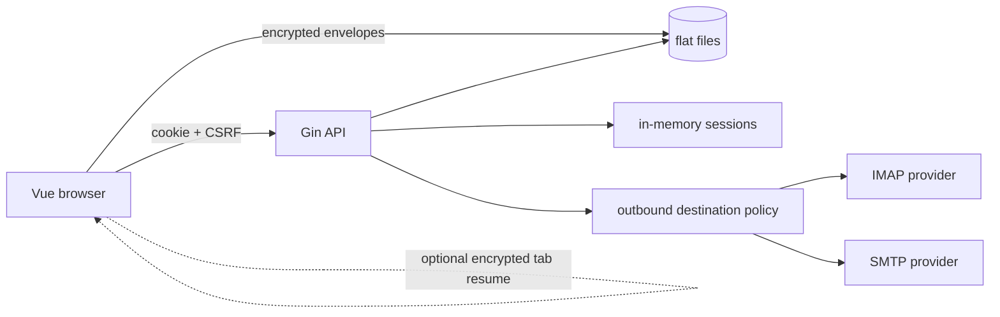
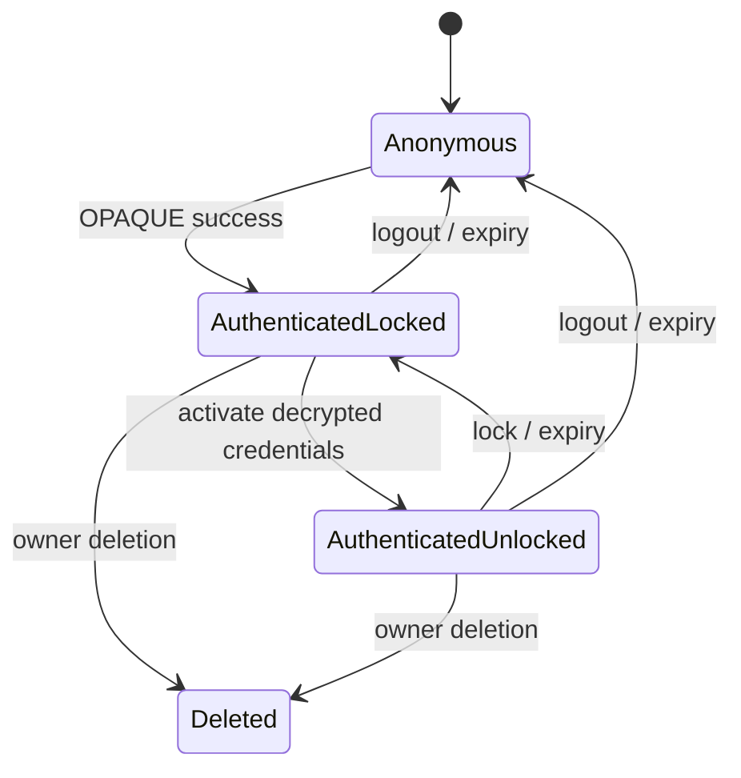
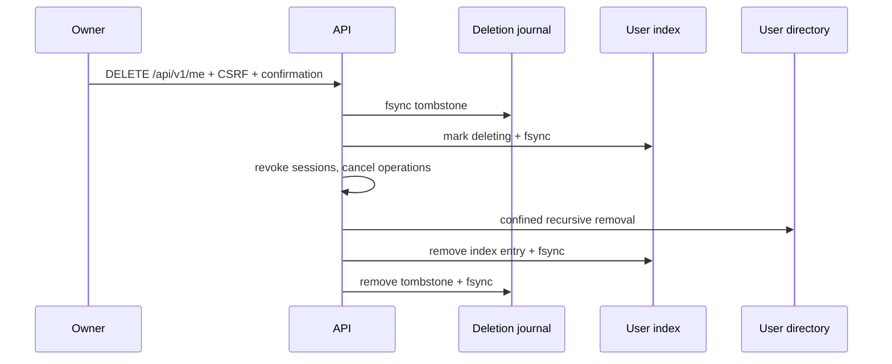

# Architecture

## Request and trust boundaries

Gin owns HTTP parsing, middleware, and safe error mapping. Business packages do
not depend on Gin. A protected request resolves the user UUID only from the
validated session, checks that the index still marks it active, then invokes a
service with that UUID. There is no arbitrary-user API.

## Authentication

The browser runs `@serenity-kit/opaque` and sends only OPAQUE protocol messages;
the main password is not part of any HTTP payload. The Go auth service uses
`github.com/bytemare/opaque`, stores the resulting registration record in that
user's `auth.json`, and keeps short-lived KE3 verification state in memory.
After KE3 validation, it creates a fresh cookie session. The same flow is used
for recent reauthentication, scoped to the authenticated user's UUID. Unknown
logins receive an OPAQUE fake record. Setup material is external configuration,
not a vault decryption key. The HTTP session remains authenticated-but-locked
until the client unlocks the vault.

## Vault and files

The browser wraps a random VMK using an Argon2id-derived KEK. HKDF derives one
AES key per file identifier and key version. AES-GCM AAD is an unambiguous
length-prefixed encoding of application context, user UUID, file identifier,
format version, and key version. Each encrypted file has an independent nonce.

The server validates envelope shape and cryptographic parameter bounds but has
no key to authenticate or decrypt ciphertext. Writes require the prior ETag.
Atomicity covers one file only; coordinated changes must use a journal.

## Sessions

Only SHA-256 hashes of random cookie tokens are indexed in RAM. CSRF values are
independent random values. Session credentials are copied into per-session maps,
expired with the session, and best-effort overwritten when removed. Go cannot
promise physical RAM erasure.

The browser can resume its vault after a reload in the same tab. The 32-byte VMK
is AES-GCM sealed in sessionStorage; its separate non-extractable WebCrypto
wrapping key is kept in IndexedDB, not exported or sent to the server. AAD binds
the envelope to the user, CSRF session and explicit server `lock_revision`.
Restore verifies the authenticated server session before and after decrypting.
Explicit lock increments that revision; expiring upstream credentials does not.
Lock/logout wipe the live VMK and remove the tab envelope/wrapping key; same-origin
tabs receive a lock notification. Interrupted async writes cannot resurrect a key.
Orphan wrapping keys expire after 24 hours and are pruned on startup.

Human pointer/keyboard/scroll/touch activity, not mailbox polling, resets a
configurable 1/5/10/15/30/60-minute deadline (default 15). Visibility/page resume
also checks that deadline; refreshing does not reset it. Resume can be disabled
in Settings. Browser session recovery may restore sessionStorage after closing;
the inactivity and server-session checks still apply. This is a trusted-browser
convenience, not protection from XSS or full browser-profile compromise. If secure
browser storage is unavailable, the app keeps RAM-only behavior and says so.

## Account deletion

Startup merges deleting index entries with tombstones and resumes the sequence.
The target is reconstructed from a parsed UUID below the fixed users directory.

## Mail lifecycle

IMAP monitoring uses one verified TLS/STARTTLS connection per receiving identity
with read-only EXAMINE and IDLE. Counts (messages, unseen, UIDNEXT, UIDVALIDITY)
are forwarded as authenticated, CSRF-protected NDJSON updates. Unsupported or
broken IDLE falls back to short-lived STATUS requests at the selected interval
(15 seconds to 5 minutes, 30 seconds by default). The non-secret interval is a
browser-local preference in Settings. Monitoring itself fetches no message bodies
or attachments. The reader separately fetches summaries in windows of 50 using
read-only EXAMINE and FETCH. Pagination anchors use UID + UIDVALIDITY, with a
bounded UID lookup of the prior page anchor instead of SEARCH ALL. An expunged
anchor or changed UIDVALIDITY requires refreshing the list.

The encrypted per-account `sync_folders` opt-in adds LIST/STATUS snapshots at
the configured fallback interval, on at most two transient browser requests.
The server caps discovery at 200 folders and 25 seconds. Folder selection is
carried through every message operation (including flags, source, downloads and
redirect) so identical UIDs in different folders cannot be confused. The inbox
retains IDLE; extra folders do not each consume an idle connection. Nothing is
copied to disk and no folders are created or changed.

Temporary activation DNS failures are 503, not invalid-input errors. Monitoring
and list reads use abortable exponential reconnect delays of 3–30 seconds, with
at most two list loads in flight, and resume on browser visibility/online events.
Authentication rejection is distinct and not automatically retried. Existing
rows and the open reader stay visible during refresh. Flag changes update local
state and let the status notification trigger one refresh, without restarting
the monitoring stream. Sending and redirecting are never automatically retried.

Opening a message fetches its envelope and extended BODYSTRUCTURE, then only
the selected plain/HTML MIME alternatives via bounded BODY.PEEK sections.
Transfer encodings and charsets are decoded, with a 2 MiB decoded limit per
text alternative. Large alternatives are skipped with a visible warning.
Attachments are listed as metadata and fetched only on demand (10 MiB decoded
limit, encoding-aware wire limits). Downloads preserve original file bytes.
Operations share the upstream connection budget, use verified TLS/STARTTLS and
the outbound policy, and are cancelled by lock/logout, account deletion or
request cancellation. Responses are no-store; no message cache is written to disk.

Incoming HTML uses a dedicated bluemonday policy with passive inline formatting
and tables. Bounded simple stylesheet rules are parsed by douceur, sanitized and
retained; at-rules, CSS URLs and unsafe properties are dropped. A dedicated
authenticated document route has an independent CSP allowing safe inline styles,
so the main app keeps its inline-style prohibition. The iframe is opaque-origin
sandboxed without script/form privileges. External images become visible blocked
placeholders and are blocked
by CSP by default; one-message or encrypted exact sender/domain consent can enable
HTTP(S) images directly in the browser (never proxied by the Go server). Consent
does not permit scripts, remote CSS/fonts, frames or forms, and sender addresses
may be spoofed. Plain text and original-source views are escaped by Vue.
Content/pending actions are cleared on lock/unmount; late responses are discarded.

Read-only retrieval does not change flags. CSRF-protected seen/unseen POST routes
use read-write SELECT, UIDVALIDITY checks and targeted UID STORE +/-Seen. A
per-mailbox encrypted preference can mark opened messages read automatically;
manual read/unread controls work in either mode. Full original source retrieval
is on-demand and capped at 20 MiB; .eml downloads preserve original bytes.
Provider-side text/read/sender searches use bounded 4,096-message sequence
windows and fetch at most 50 matched envelopes. Queries are cancelled/debounced;
search/filter state is memory-only and cleared on lock. Large scans are capped
at 64 windows and the existing operation deadline, with an explicit error rather
than silently treating incomplete results as a complete search.

Reply/reply-all prepare drafts using Reply-To and exclude/deduplicate the user's
addresses; In-Reply-To is retained for threading. An opt-in encrypted IMAP
preference matches the user's sender to the original To/Cc using configured SMTP
addresses only, or falls back to the first available sender. Forwarding prepares editable
quoted content and explicitly downloads the selected message's attachments into
the draft, with no silent partial omission. Redirect retrieves the authorized
original from IMAP, adds Resent headers and binds the SMTP envelope to the chosen
activated sending identity. It strips Bcc/Resent-Bcc while preserving the original
From/body, and provider rejection/ambiguous submission is reported without retry.

Connection probes verify provider TLS/authentication without MAIL/DATA. One
attempt per IP every 30 seconds is shared by SMTP/IMAP, with a bounded RAM limiter
and Retry-After. The probe route requires authentication/CSRF; trusted-proxy
configuration controls IP extraction. This limit does not throttle normal inbox
refreshes or sending. Process restart clears the limiter.

The browser sends presence every 15 seconds; the server closes all stream-owned
connections after 45 seconds without presence. Hidden tabs abort immediately and
resume on visibility. Lock/logout, session expiry, credential expiry, account
configuration changes, request disconnects and server shutdown cancel watches.
Watch IDs are bound to their session. Monitoring allows `MAX_ACCOUNTS` connections per user (default 20), with a
separate interactive reserve of at least two connections or 20% of that limit.
Global budgets are `max(64, MAX_ACCOUNTS)` monitoring and 16 interactive connections. Initial connection/authentication is bounded to 20 seconds.
Credentials stay in memory and are cleared after all stream workers terminate.
Rejected IMAP logins are not repeatedly retried inside an active watch.

SMTP sending identities are stored with sender name/email and connection
credentials in the encrypted `smtp` collection. Receiving identities in
`accounts` can optionally reference a sending identity; neither is required
to create the other. Removing an identity clears active credentials in the current
session before updating its encrypted collection. Sender removal unlinks but
does not delete receiving mailboxes; unlinking and sender deletion are separate
ETag-protected writes, so a later conflict is reported without claiming deletion.
Removing a default selects a remaining identity as the fallback.
Editing updates the existing encrypted record in place, preserving its ID,
default status and links. An empty password field keeps the saved IMAP/SMTP password;
it is never prefilled into the edit form. Edits also clear active credentials
before saving so subsequent operations activate the updated configuration.
The unlocked browser activates one sending identity in
session memory, then submits HTML with a plain-text alternative and optional base64 attachments
through `/messages/send`. Attachments are read and encoded in browser memory;
the API accepts up to 20 files totalling 10 MiB. Only this endpoint has a separate
20 MiB JSON request limit to allow encoding overhead; other request limits are
unchanged. The server builds MIME in memory without multipart upload temp files.
The Tiptap editor supports headings, text sizes, colors, highlights, alignment,
bold/italic/underline/strike, quotes, lists and links. The server keeps only an
allowlist of formatting tags, bounded font sizes, literal hex/RGB colors,
alignment and http/https/mailto links, removing scripts, event handlers,
unapproved CSS, remote images and embedded content before MIME
encoding. No remote editor assets or external services are used.
The handler binds From to that session identity and sends once using the
outbound policy and verified TLS/STARTTLS. Bcc is included only in the SMTP
envelope. Bodies and attachments are never persisted. On acceptance, the browser
returns to the inbox with a confirmation; failed or ambiguous sends preserve the
draft without retries. Active sends are cancelled during account
deletion. IMAP Sent APPEND is implemented: on SMTP acceptance, the server
selects the existing Sent folder (mapped or SPECIAL-USE), checks for the
Message-ID (or Resent-Message-ID for redirects) to avoid duplicates, and
performs a single APPEND with the Seen flag and sending date. The private copy
includes Bcc; the SMTP payload never does. Copies stay on the mail provider,
not local disk. A failed APPEND still returns HTTP 200 with `status:sent` and
a separate explanatory message; no send is retried automatically.

## Optional external mail clients

`internal/mailproxy` owns independent TLS IMAP and SMTP listeners. The operator
enables them at startup; per-user activation is managed by the authenticated,
CSRF- and ETag-protected `/proxy` API. `proxy.json` contains a separate encrypted
snapshot of selected provider credentials, sealed with a dedicated password using
Argon2id/AES-GCM. AAD binds the user and encrypted source collection revisions.
The API never returns the password, ciphertext or provider secrets. No VMK is
sent to the gateway, and normal OPAQUE authentication remains unchanged.

IMAP validates local LOGIN/SASL PLAIN credentials, authenticates to the chosen
provider over verified TLS/STARTTLS, then transparently relays authenticated
commands and responses, including provider capabilities and IDLE. SMTP uses
`go-smtp` for submission: local authentication selects the user's enabled sender
map, MAIL FROM chooses one of those providers, and DATA rejects mismatched or
duplicate author headers before opening the provider submission. SMTP LOGIN and
PLAIN are available only within the implicit TLS connection. MIME is retained;
there is no disk spool, retry queue, or gateway-managed Sent append.

Connections join the operation registry so deletion cancels them. Proxy
revocation/password replacement cancels both services, while encrypted identity
updates invalidate the source revision and close the user's established proxy
connections. Browser lock/logout only affect web sessions. Client access remains
usable across process restarts via its encrypted snapshot. Resource limits bound
connections, Argon2 workers and message buffers; failed authentication shares a
30-second source-IP cooldown across IMAP and SMTP.

## Unified inbox

The browser merges independently paginated mailbox windows by date/account/UID,
with two concurrent transient requests at most and account-specific failures.
The sidebar can filter to one receiving identity. Each load-older action advances
the visible accounts' UID anchors; IDLE count changes refresh the windows. This
is a bounded merge of loaded messages, not perfect global snapshot pagination
under concurrent mailbox changes. A server-owned signed unified cursor remains
a future improvement.

## Local drafts and configuration portability

The browser autosaves drafts in IndexedDB with VMK-derived HKDF/AES-GCM keys.
Attachment content and its name, type, size and timestamp share an authenticated
envelope. Legacy plaintext attachment descriptors are migrated after their owner
unlocks, using conditional replacement so migration cannot overwrite newer edits.
Drafts expire after seven days. Flush precedes lock/navigation; storage failures
produce a warning instead of a claim that the latest draft was saved. A restored
composer is read-only while its earlier SMTP submission is pending; it cannot be
edited or submitted a second time until the outcome is known. Accepted SMTP may
finish after browser lock/logout, and its result is shown after unlocking.

Settings exports decrypt all three configuration collections in the browser and
encrypt them with an independent password, Argon2id (64 MiB, t=3, p=1) and AES-GCM.
An unreadable collection aborts the export. Imports validate identities, links and
instance limits, re-encrypt with the destination VMK, and submit one revision
conditional `/vault/import`. A durable `.vault-import.json` in the user directory
contains only encrypted envelopes. Under the per-user store lock, recovery finishes
a committed replacement before exposing any collection. Startup finishes pending
imports before serving requests; malformed recovery data stops access/startup.
Imports revoke the user's sessions and active operations and invalidate proxy
snapshots. This is a specific three-collection transaction; other multi-file
operations do not acquire transactional semantics automatically.

## Recoverable credential generations

Every real OPAQUE session and pending login captures the `auth.json` revision.
Authenticated middleware rejects earlier generations. Password updates commit
`auth.json`, `vault.json`, five encrypted collections and disabled `proxy.json`
using `.credentials-update.json` under the user's store lock. All expected
revisions are checked before journal installation; startup and reads finish
committed journals before exposing any file. Old-session file writes also check
the authentication revision while holding that same lock. Rewrap preserves the
VMK; rotation encrypts collections with a fresh browser-generated VMK and an
incremented key version. Provider operations and sessions are revoked afterwards.

IMAP flag, folder and same-account transfer actions use the same session-scoped,
cancellable interactive connection budget as reads. COPY/MOVE stays on the
provider. The fallback requires UIDPLUS, a confirmed COPY, then targeted UID
EXPUNGE; no unrestricted EXPUNGE or disk spool is used. Batch selection exists
only in browser RAM and stops on the first unconfirmed result.
